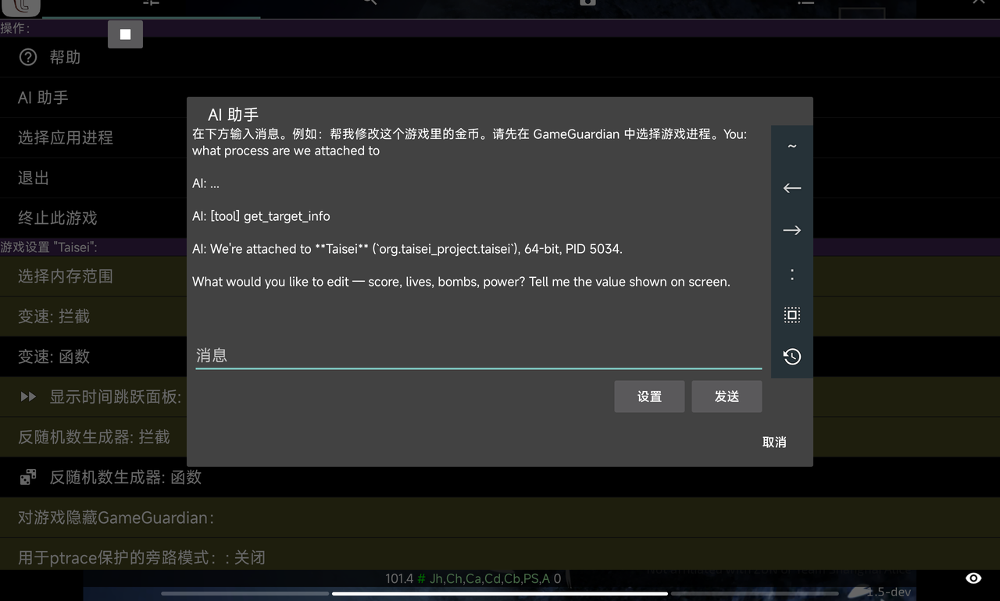

# GameGuardian with AI

**English** | [简体中文](README.zh-CN.md)

---

**Open-Guardian + a built-in AI assistant: the model drives the real GameGuardian engine through function calling.**

This is Open-Guardian (the offline, privacy-cleaned rebuild of GameGuardian 101.4) with an
AI assistant built into the panel. You open a chat dialog in the GameGuardian menu, tell it
what you want ("change my coins", "freeze my HP"), and the model — any OpenAI-compatible
model — drives the **real** memory engine: search, refine, read, write and freeze, all
through the native `gg.*` API with its correct threading.

No engine was re-implemented. When the AI calls a tool, it lands in the exact same code
path a GameGuardian Lua script would use.



Above: a live session on-device — the user asks *"what process are we attached to"*,
the model calls `get_target_info`, and the answer (Taisei, 64-bit, PID) comes from the
real engine.

## How it works

```
config menu → AI 助手 → chat dialog (GameGuardian's own dialog style)
      ↓
embedded Lua script  ── runs on the real GG script engine
      ↓ gg.aiRequest(messages)
OpenAI-compatible chat/completions with tool definitions
      ↓ function calling
search_number / refine_number / get_results / read_values /
write_values / freeze_values / clear_results / get_target_info
      ↓
native gg.* API → real memory engine → tool results → final answer
```

- **One generic OpenAI-compatible client** (base URL + key + model) — works with
  DeepSeek, Kimi, Zhipu, OpenRouter, Ollama, or any compatible endpoint. No
  per-vendor modules.
- **The assistant is a Lua script** launched through GameGuardian's own
  `Script` string-source thread — so every tool call goes through the native
  API with its correct sync and UI choreography.
- **Privacy stays**: the AI talks only to the endpoint you configure, only when
  you send a message. The rest of the app remains the zero-telemetry
  Open-Guardian build.

## The tools the model can call

| Tool | Maps to |
|---|---|
| `search_number` | `gg.searchNumber` |
| `refine_number` | `gg.refineNumber` |
| `get_results` | `gg.getResults` |
| `read_values` | `gg.getValues` |
| `write_values` | `gg.setValues` |
| `freeze_values` | `gg.setValues` + `gg.addListItems` (frozen) |
| `clear_results` | `gg.clearResults` |
| `get_target_info` | `gg.getTargetInfo` |

Config lives in the app's settings dialog: API base URL, API key (optional),
model name — persisted in the app's shared preferences.

## Setup on device

1. Attach a game process in GameGuardian first.
2. Config menu → **AI 助手** → 设置 (Settings) → fill base URL / key / model.
   Example: `https://api.chatanywhere.tech/v1` + `deepseek-v4.1-flash`.
3. Type a request. Example: "help me change the coins in this game — current
   value is 5320". The AI will search, guide you through refine steps, then
   write or freeze the value.

## Building

Same as Open-Guardian: JDK 17+, Android SDK with `platforms/android-34` and
`build-tools/34.0.0`.

```bash
export ANDROID_HOME=/path/to/android-sdk
./gradlew :app:assembleRelease
```

Unsigned unless you provide your own keystore at `keystore/release.jks`
(git-ignored). New source added on top of Open-Guardian:

```
app/src/main/java/android/ext/ai/     AiConfig, AiClient, AiTools, AiJson,
                                      AiScriptSource, AiController (+ $-classes)
app/src/main/java/android/ext/Script$ai*.java    gg.aiRequest / aiWaitUser / aiShow
app/src/main/res/layout/ai_chat.xml, ai_settings.xml
```

## Legal

GameGuardian is a commercial product of GameGuardian Ltd. This repo is a
static-analysis reconstruction for educational and interoperability purposes;
the original APK is not included. The original code belongs to its authors.
