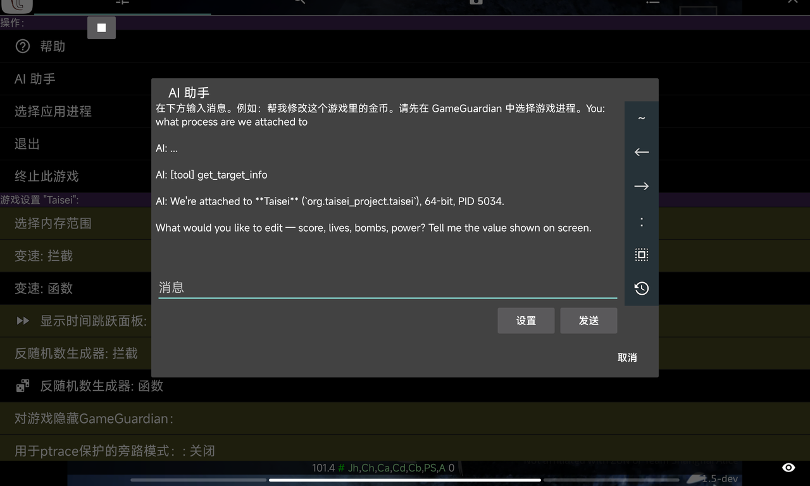

# GameGuardian with AI

[English](README.md) | **简体中文**

---

**Open-Guardian + 内置 AI 助手：模型通过函数调用驱动真正的 GameGuardian 引擎。**

这是在 Open-Guardian（去网络化、隐私净化的 GameGuardian 101.4 重构版）基础上内置的
AI 助手。在 GameGuardian 菜单里打开聊天对话框，直接说需求（「改金币」「锁血」），
任意 OpenAI 兼容模型就会驱动**真正的**内存引擎：搜索、筛选、读取、修改、冻结，
全部通过原生 `gg.*` API 及其正确的线程调度完成。

引擎零重实现。AI 调用工具时，走的是 GameGuardian Lua 脚本完全相同的代码路径。



上图为真机实时会话——用户问「我们附加的是哪个进程」，模型调用 `get_target_info`，
答案（Taisei、64 位、PID）来自真实引擎。

## 工作原理

```
配置菜单 → AI 助手 → 聊天对话框（GameGuardian 自身风格）
      ↓
内置 Lua 脚本 ── 跑在真正的 GG 脚本引擎线程上
      ↓ gg.aiRequest(messages)
OpenAI 兼容 chat/completions（带工具定义）
      ↓ 函数调用
search_number / refine_number / get_results / read_values /
write_values / freeze_values / clear_results / get_target_info
      ↓
原生 gg.* API → 真实内存引擎 → 工具结果 → 最终回答
```

- **一个通用 OpenAI 兼容客户端**（地址 + 密钥 + 模型名）——DeepSeek、Kimi、智谱、
  OpenRouter、Ollama 等任何兼容端点都能直接用，无需为每家单独写模块。
- **助手本体是 Lua 脚本**，通过 GameGuardian 自己的 `Script` 字符串源线程启动——
  每次工具调用都走原生 API 的正确同步与 UI 流程。
- **隐私保持**：AI 只连你配置的端点，只在你发消息时请求。应用其余部分仍是
  零遥测的 Open-Guardian 构建。

## 模型可调用的工具

| 工具 | 对应 |
|---|---|
| `search_number` | `gg.searchNumber` |
| `refine_number` | `gg.refineNumber` |
| `get_results` | `gg.getResults` |
| `read_values` | `gg.getValues` |
| `write_values` | `gg.setValues` |
| `freeze_values` | `gg.setValues` + `gg.addListItems`（冻结） |
| `clear_results` | `gg.clearResults` |
| `get_target_info` | `gg.getTargetInfo` |

配置在应用内的设置对话框：API 地址、密钥（可选）、模型名——保存在应用私有偏好中。

## 真机使用

1. 先在 GameGuardian 里附加游戏进程。
2. 配置菜单 → **AI 助手** → 设置 → 填地址 / 密钥 / 模型。
   例：`https://api.chatanywhere.tech/v1` + `deepseek-v4.1-flash`。
3. 直接输入需求，例如：「帮我改这个游戏的金币，当前是 5320」。AI 会搜索、
   引导你完成筛选，然后修改或冻结数值。

## 编译

与 Open-Guardian 相同：JDK 17+，Android SDK 带 `platforms/android-34` 与
`build-tools/34.0.0`。

```bash
export ANDROID_HOME=/path/to/android-sdk
./gradlew :app:assembleRelease
```

除非在 `keystore/release.jks` 放自己的密钥（已被 git 忽略），否则输出未签名。
在 Open-Guardian 之上新增的源码：

```
app/src/main/java/android/ext/ai/     AiConfig、AiClient、AiTools、AiJson、
                                      AiScriptSource、AiController（含 $ 类）
app/src/main/java/android/ext/Script$ai*.java    gg.aiRequest / aiWaitUser / aiShow
app/src/main/res/layout/ai_chat.xml、ai_settings.xml
```

## 法律声明

GameGuardian 是 GameGuardian Ltd. 的商业产品。本仓库是通过 APK 静态分析为
教育与互操作性目的制作的重构版本，不包含原始二进制文件。原始代码的著作权
归 GameGuardian Ltd. 作者所有。
